# Database Relationships

The schema is deliberately relational: every financial row belongs to a household, and the
user who recorded it is always identifiable. No table stores a derived balance.

```mermaid
erDiagram
    HOUSEHOLDS ||--|| HOUSEHOLD_SETTINGS : "has settings"
    HOUSEHOLDS ||--o{ HOUSEHOLD_MEMBERS : "has members"
    HOUSEHOLDS ||--o{ ACCOUNTS : "owns"
    HOUSEHOLDS ||--o{ CATEGORIES : "defines"
    HOUSEHOLDS ||--o{ TRANSACTIONS : "records"
    HOUSEHOLDS ||--o{ TRANSFERS : "records"
    HOUSEHOLDS ||--o{ BUDGETS : "plans"
    HOUSEHOLDS ||--o{ RECURRING_RULES : "schedules"
    HOUSEHOLDS ||--o{ SAVINGS_GOALS : "targets"
    HOUSEHOLDS ||--o{ LOANS : "tracks"
    HOUSEHOLDS ||--o{ NOTIFICATIONS : "raises"
    HOUSEHOLDS ||--o{ AUDIT_LOGS : "audits"

    USERS ||--o{ HOUSEHOLD_MEMBERS : "belongs to"
    USERS ||--o{ ACCOUNTS : "owns (optional)"
    USERS ||--o{ TRANSACTIONS : "creates / owns"
    USERS ||--o{ TRANSFERS : "creates"
    USERS ||--o{ BUDGETS : "owns (optional)"
    USERS ||--o{ SAVINGS_GOALS : "owns (optional)"
    USERS ||--o{ SAVINGS_CONTRIBUTIONS : "contributes"
    USERS ||--o{ LOAN_REPAYMENTS : "repays"
    USERS ||--o{ NOTIFICATIONS : "receives (optional)"
    USERS ||--o{ AUDIT_LOGS : "acts"

    ACCOUNTS ||--o{ TRANSACTIONS : "funds"
    ACCOUNTS ||--o{ TRANSFERS_FROM : "source"
    ACCOUNTS ||--o{ TRANSFERS_TO : "destination"
    ACCOUNTS ||--o{ SAVINGS_CONTRIBUTIONS : "funds"
    ACCOUNTS ||--o{ LOAN_REPAYMENTS : "funds"

    CATEGORIES ||--o{ SUBCATEGORIES : "contains"
    CATEGORIES ||--o{ TRANSACTIONS : "classifies"
    CATEGORIES ||--o{ BUDGET_ALLOCATIONS : "allocated"
    CATEGORIES ||--o{ RECURRING_RULES : "classifies"

    TRANSACTIONS ||--o{ TRANSACTION_ATTACHMENTS : "has receipts"
    TRANSACTIONS ||--o{ TRANSACTIONS : "duplicate_of"

    BUDGETS ||--o{ BUDGET_ALLOCATIONS : "splits into"

    SAVINGS_GOALS ||--o{ SAVINGS_CONTRIBUTIONS : "collects"

    LOANS ||--o{ LOAN_REPAYMENTS : "receives"
```



## Relationship rules

| Relationship | Cardinality | Behaviour | Why it matters |
| --- | --- | --- | --- |
| household → users (through `household_members`) | 1 : N | membership row cascades | Roles live on membership, not on the person |
| user → accounts | 1 : N, nullable on account | `owner_user_id NULL` = shared | Shared vs personal accounts |
| account → transactions | 1 : N | `RESTRICT`/soft-deactivate | Accounts with history can never vanish |
| category → transactions | 1 : N | `SET NULL` on delete | Categories can be retired without losing history |
| category → subcategories | 1 : N | `CASCADE` | Deleting a category removes only its labels |
| transaction → attachments | 1 : N | `CASCADE` | Removing a transaction cannot orphan receipt files |
| transaction → transactions | 0..1 : 1 | self-reference | Duplicate marker |
| budget → allocations | 1 : N | `CASCADE` | Allocations only exist inside a budget |
| goal → contributions | 1 : N | `CASCADE` | Contributions belong to a goal |
| loan → repayments | 1 : N | `CASCADE` | Repayments belong to a loan |

## Ownership vs scope (important)

`transactions.scope` and `accounts.owner_user_id` are **independent**:

```
account.owner_user_id = NULL           →  shared account
transactions.scope = 'personal'        →  personal money movement
```

A shared account can pay for a personal expense. The shared balance falls (money physically
left the account) while the expense remains personal in every report. Visibility follows the
same rule: personal transactions are visible to the owner and administrator; shared
transactions are visible to the whole household.

## Derived values (never stored)

| Value | Formula | Source |
| --- | --- | --- |
| Account balance | opening + posted income + transfers in − posted expenses − transfers out | `services/accounts.py` |
| Budget actual | Σ posted expenses matching the budget scope and period | `services/budgets.py` |
| Goal progress | Σ contributions ÷ target | `services/` dashboard + savings endpoints |
| Loan outstanding | principal − Σ principal repaid | `endpoints/loans.py` |
| Cash flow | posted income − posted expenses (never transfers/contributions/loan principal) | `services/dashboard.py`, reports |
| Net worth indicator | Σ visible account balances | dashboard / account report |

## Deletion and reversal

```
transactions.status: draft ─▶ posted ─▶ reversed
                                  │          │
                                  └─ reversed_at, reversed_reason, reversed_by, audit log
```

* Drafts may be hard-deleted because they never affected balances.
* Posted transactions and transfers are **reversed**, never destroyed.
* Accounts, members, budgets, goals and rules use `is_active` / status flags.
* The audit log is append-only; it stores before/after JSON snapshots for every mutation.
